<p align="center"></p>

<h1 align="center">收藏学习台 · Fav Study</h1>

<p align="center">把抖音、小红书里收藏的干货视频，变成一本能读、能划线、能按专题学的本地书<br>
Turn the videos you save on Douyin and Xiaohongshu into a local, readable library you can highlight and study by topic.</p>

<p align="center">


</p>

**抖音 / 小红书收藏 → 下载进本地视频库 → 本机转文字 → AI 保留原话润色排版 → 学习库（阅读版）→ 专题学习**

- 视频只在你自己的电脑上下载、转写；只有文字会发给你自己选的 AI（也可以用本机的 Claude Code / Codex 订阅）
- 用你自己的抖音、小红书登录，一条一条慢慢读，防封号
- 学习库就是一本按「分类 → 大类 → 小主题」排好的书：划线、记笔记、按专题把视频攒到一起看

> Everything runs on your own computer with your own Douyin / Xiaohongshu login. Transcripts are lightly cleaned up by the AI you choose (typos and filler words only, at most 15% changed) and laid out as a readable library, organised by category, with highlights, starred picks and topic collections. The UI is in Chinese.

## 功能一览 · Features

| | |
|---|---|
| **两个平台一起管**：抖音、小红书的收藏同步、链接粘贴、下载都支持；本地视频库按平台、收藏夹分类放好 | **保留原话的润色**：只改错字、删口水词、补标点、分段加小标题，逐字改动超过 15% 自动让 AI 改回原话 |
| **学习库 = 阅读版**：一篇篇排好的文章，侧边目录，原视频弹窗播放，一个分类连播 / 洗牌 | **划线和笔记**：选中文字一键三连（复制 + 高亮 + 加入专题笔记），高亮会保存 |
| **专题整理**：自建三级分类和专题，从任何分类挑视频进来集中学；每个专题一份随手记的笔记 | **复制到桌面**：专题里的视频按顺序编号复制到「专题学习」文件夹，方便剪辑 |
| **代刷**：按关键词用抖音、小红书自己的搜索补新视频进专题，插队处理，AI 判断无关的自动拿出 | **精品**：给文章点星，复制一份到「精品」tab，保留原分类作目录 |
| **每周 / 按月整理**：一键增量同步两个平台的新收藏，下载、转写、润色，生成周报；随时可以停 | **防封号**：一条一条来，小红书有冷却、每日上限、随机间隔；整理前先检查登录 |
| **回收站**：删除可以恢复，也可以彻底删除；代刷来的统一先放回收站，不混进你的收藏 | **去重**：每条收藏一个唯一的 uid（平台 + 作品 ID，或本地文件指纹），同一个视频进不来两次 |

<table>
<tr>
<td>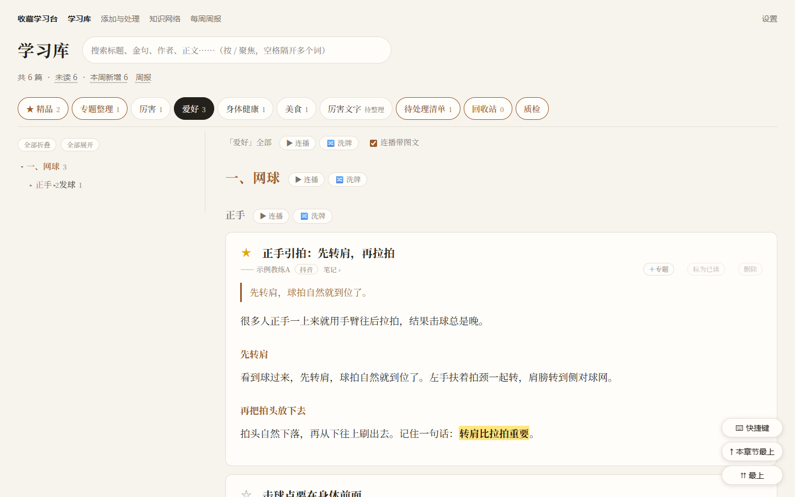<br><sub>学习库：按分类 → 大类 → 小主题排好的阅读版</sub></td>
<td>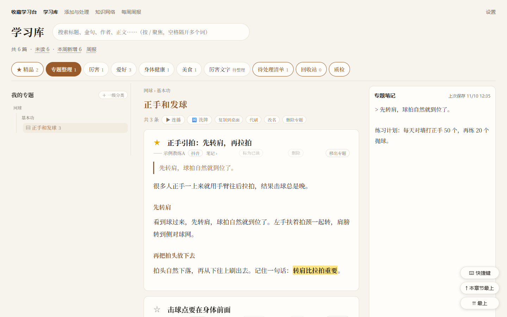<br><sub>专题整理：三级分类、专题文章、右侧专题笔记</sub></td>
</tr>
<tr>
<td>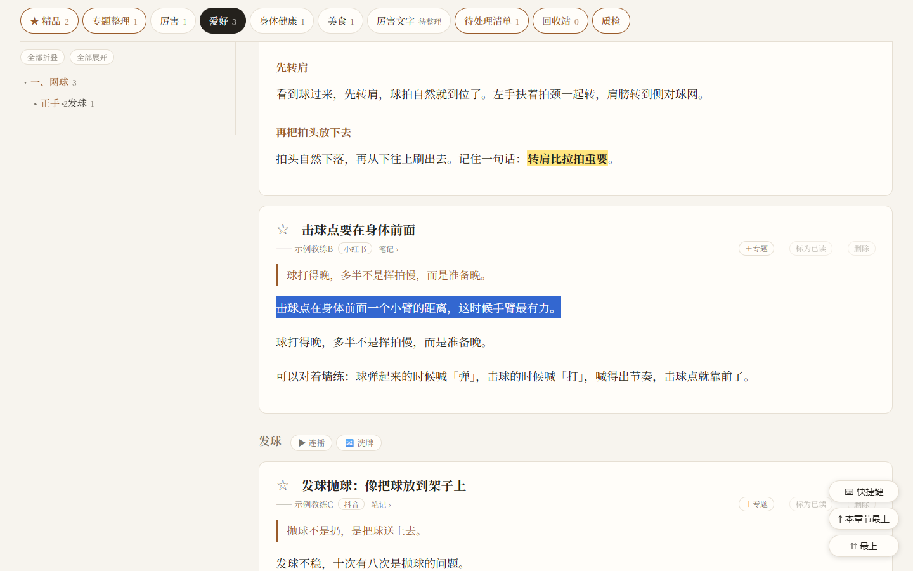<br><sub>选中文字：一键三连 / 高亮 / 复制 / 加入专题笔记</sub></td>
<td>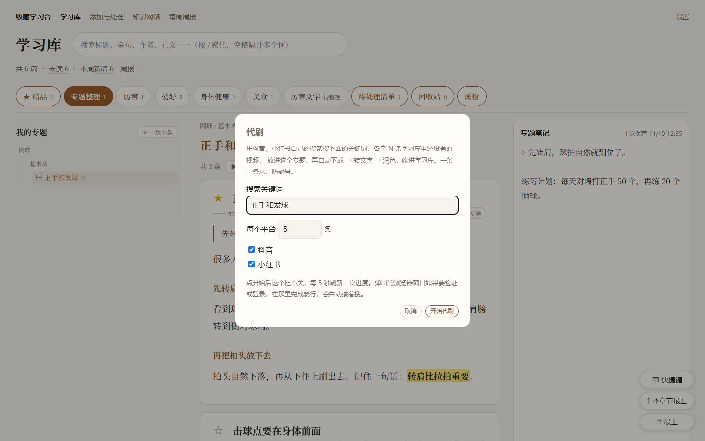<br><sub>代刷：按关键词补新视频进专题</sub></td>
</tr>
<tr>
<td>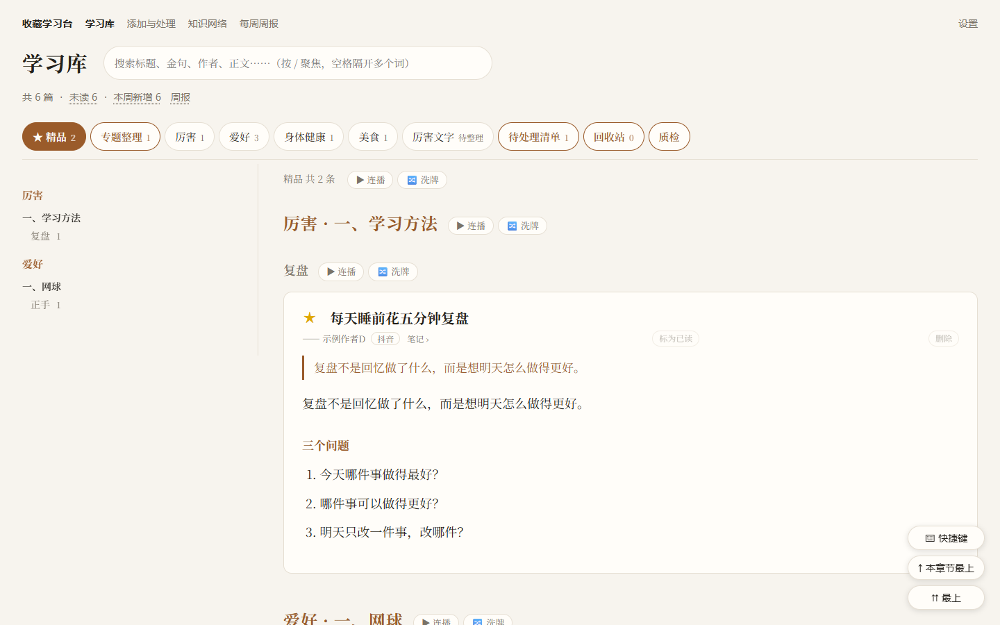<br><sub>精品：点星收藏，保留原分类的目录</sub></td>
<td>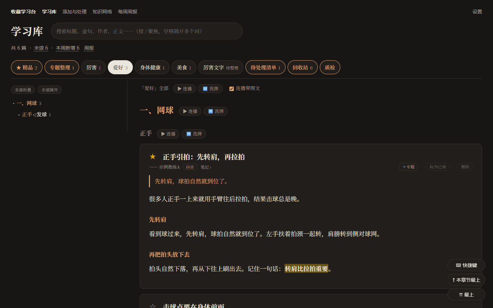<br><sub>跟随系统的深色模式</sub></td>
</tr>
<tr>
<td>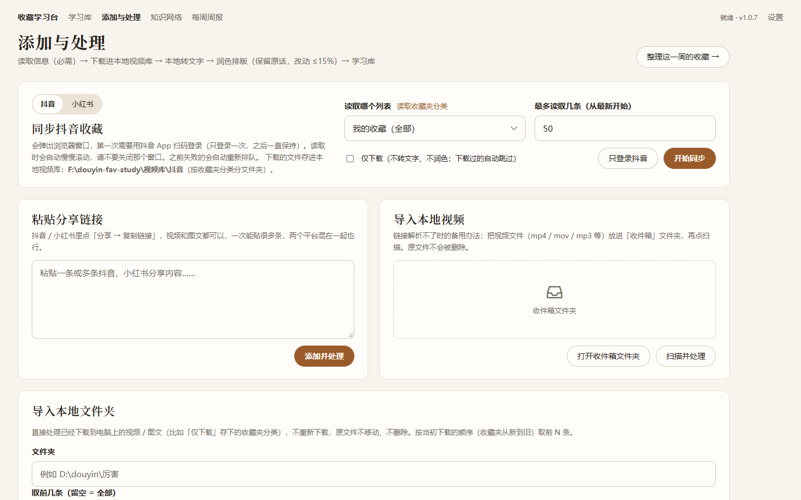<br><sub>添加与处理：抖音 / 小红书切换，同步收藏、粘贴链接、导入本地视频</sub></td>
<td>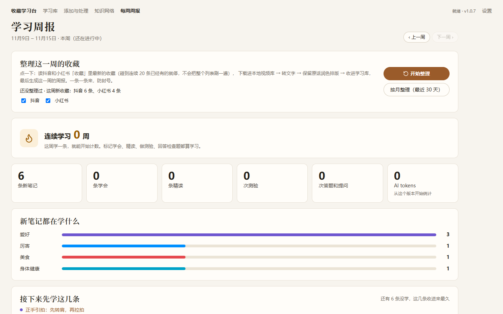<br><sub>每周周报：一键整理这一周 / 最近 30 天的收藏</sub></td>
</tr>
</table>

截图里都是演示数据（[`scripts/make_demo.py`](scripts/make_demo.py) 生成），不是真实收藏。

## 快速开始 · Quick start

### 开始前先看这 4 点

1. **要用电脑。** Windows 和 Mac 都行，手机只用来在 App 里复制分享链接。
2. **可以不花钱。** AI 用设置页的「免费方案」（智谱 GLM / 硅基流动 / Gemini），或者用你本机已经登录的 Claude Code / Codex 订阅。
3. **不用写代码。** 装一次 Python 3.12，双击安装脚本就好。
4. **收藏和笔记只在你自己电脑上。** 只有转出来的文字会发给你选的 AI。

### 10 分钟上手

1. **下载本仓库**：右上角 **Code → Download ZIP** 解压，或者 `git clone https://github.com/shawnwang-sg/douyin-fav-study.git`。
2. **安装**：装好 [Python 3.12](https://www.python.org/downloads/)，然后 Windows 双击 `install_windows.bat`，Mac 右键 `install_mac.command` → 打开。
3. **打开**：Windows 双击 `start_windows.bat`，Mac 双击 `start_mac.command`。黑色窗口别关，浏览器会自动打开 `http://127.0.0.1:8765`。
4. **跟着「开始使用」页走**：配好 AI → 选你收藏的主要是什么 → 粘贴第一条链接 → 打开第一篇文章。之后到「添加与处理」切到小红书，同样能同步收藏。

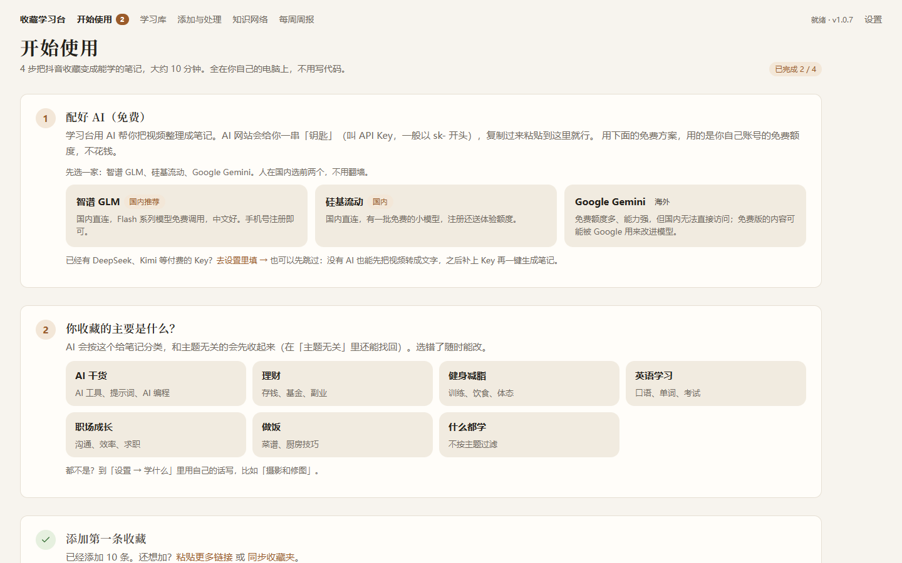

想先看看效果、不碰自己的账号：用演示数据启动（见下面「[演示数据](#演示数据--demo-data)」）。

### 卡住了？最常见的情况

| 看到什么 | 怎么办 |
|---|---|
| 小红书扫码登录成功，又弹出一个没登录的二维码 | 海外网络会被跳到 rednote.com，它和 xiaohongshu.com 的登录不通用。按登录框里的提示，扫**这个窗口里**的二维码；网络（VPN / 加速器）别在登录后再切换 |
| 「API Key 无效（401）」 | Key 没复制完整或带了空格，回「设置 → 免费方案」重新粘贴 |
| 「免费额度用完了（429）」 | 一般第二天恢复；或者换一家，或者改用本机 Claude Code / Codex 订阅 |
| 代刷 / 同步一直没出结果 | 看一眼弹出的浏览器窗口：可能要拖滑块验证或扫码。程序会每 5 秒看一次，完成后自动接着做 |
| 小红书提示「冷却中」 | 被限流了，程序自动歇一会儿（重启也记得）。可以在「设置 → 小红书防封号」调慢一点 |
| 「没找到 XHS-Downloader」 | 小红书下载要用它，按「[一、安装](#一安装只需要一次)」第 4 步装到 `tools/XHS-Downloader` |

每条失败的内容下面都会写原因。还不行的话，在「添加与处理」页点「一键复制日志」，开 Issue 时贴上。

### Quick start (English)

1. **Get the code**: Code → Download ZIP, or `git clone https://github.com/shawnwang-sg/douyin-fav-study.git`.
2. **Install**: install [Python 3.12](https://www.python.org/downloads/) (not 3.13+), then double-click `install_windows.bat` (Windows) or right-click `install_mac.command` → Open (Mac).
3. **Launch**: `start_windows.bat` / `start_mac.command`. Keep the console window open; the app opens at `http://127.0.0.1:8765`.
4. **Follow the "开始使用" (Getting started) page**: set up an AI provider (a free plan, an API key, or your local Claude Code / Codex subscription), pick what you save, paste a first share link, and open your first article. Switch the sync card to 小红书 (Xiaohongshu) to sync favorites from there too.
5. **For Xiaohongshu downloads**, install [XHS-Downloader](https://github.com/JoeanAmier/XHS-Downloader) into `tools/XHS-Downloader` (`git clone`, then `uv sync` inside it).

---

## 一、安装（只需要一次）

### 1. Python 3.12

到 <https://www.python.org/downloads/> 下载 **Python 3.12**（3.11 也行）。**别用 3.13 或更新的**，语音识别组件还不支持。Windows 安装时勾选 **「Add python.exe to PATH」**。

### 2. 安装脚本

| 系统 | 操作 |
|---|---|
| Windows | 双击 `install_windows.bat` |
| Mac | 右键 `install_mac.command` → 打开（第一次要右键打开） |

会在程序目录里建一个 `.venv`，装好需要的组件（官方源失败会自动换清华镜像）。

### 3. 浏览器

抖音、小红书都用你电脑上的 **Edge 或 Chrome** 打开（只用来登录、读收藏列表和搜索）。都没有的话安装脚本会下载一个。

### 4. 小红书下载器（要下载小红书才需要）

小红书视频用开源的 [XHS-Downloader](https://github.com/JoeanAmier/XHS-Downloader) 下载（选最低画质，省空间）。装在程序目录的 `tools/` 下：

```bash
git clone https://github.com/JoeanAmier/XHS-Downloader.git tools/XHS-Downloader
cd tools/XHS-Downloader
uv sync
```

放在别处也行：在 `data/settings.json` 里加 `"xhs_downloader_dir": "它的路径"`，或者设环境变量 `XHS_DOWNLOADER_DIR`。

---

## 二、启动

| 系统 | 操作 |
|---|---|
| Windows | 双击 `start_windows.bat` |
| Mac | 双击 `start_mac.command` |
| 命令行 | `.venv` 里的 Python 运行 `python -X utf8 -m app`（`--port 8770` 换端口，`--no-browser` 不自动打开网页） |

黑色窗口就是程序本身，**关掉它程序就退出了**。网页地址是 `http://127.0.0.1:8765`。

---

## 三、第一次使用

### 1. 配置 AI（设置页）

| 方式 | 说明 |
|---|---|
| 免费方案 | 智谱 GLM、硅基流动（国内）或 Gemini（海外）：注册 → 创建 API Key → 粘贴后点「一键配置」 |
| 本机订阅 | 电脑上已经登录了 Claude Code 或 Codex 命令行：选「Claude Code（本机订阅，免 Key）」或 Codex，不用填 Key |
| 付费模型 | DeepSeek、Kimi、通义、OpenAI、Claude 或任何 OpenAI 兼容接口，自己填 Key 和模型 |

润色排版用的是「保留原话」规则：只改错字、删口水词、补标点、分段，不改写、不总结；改动比例可以在「设置 → 润色排版」调。小红书的防封号节奏在「设置 → 小红书防封号」调。

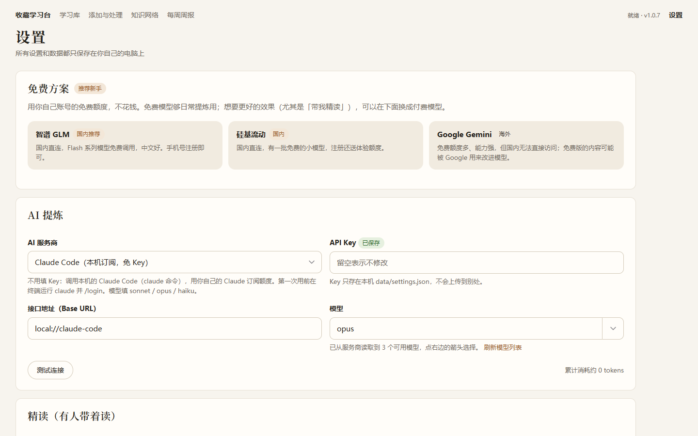

### 2. 登录抖音、小红书

第一次同步时会弹出浏览器窗口，用 App 扫码登录一次，之后一直保持。每周整理、代刷开始前会先检查登录：过期了就弹出登录窗口，扫完点「我登好了」再查；有一个平台登不上，也可以只整理已经登录的。

### 3. 添加收藏

| 方式 | 适合 |
|---|---|
| 粘贴分享链接 | 抖音、小红书「分享 → 复制链接」，一次可以贴很多条，两个平台混在一起也行 |
| 同步收藏 | 「添加与处理」顶部切到抖音或小红书，读「我的收藏」或某个收藏夹 / 专辑 |
| 每周整理 | 「每周周报」里点「开始整理」：读两个平台最新的收藏，碰到连续 20 条已经有的就停 |
| 按月整理 | 把最近 30 天的收藏完整过一遍（抖音按真实收藏时间；小红书接口不给收藏时间，按程序第一次看到的时间） |
| 导入本地视频 | 已经下载到电脑上的视频 / 图文文件夹，直接转写，不重新下载 |

---

## 四、学习

### 学习库（阅读版）

- 按「分类 tab → 大类 → 小主题」排好的文章，左边是可以折叠的目录，右下角「本章节最上 / 最上」
- 每篇文章：主题、金句、正文（保留原话），「原视频」弹窗播放本地视频；每个分类、大类、小主题都能连播 / 洗牌
- 特殊的 5 个 tab：**精品**、**专题整理**（最前），**待处理清单**、**回收站**、**质检**（最后）

### 划线和笔记

选中一段文字，弹出小工具条：

| 按钮 | 做什么 |
|---|---|
| 一键三连 | 复制 + 高亮 + 加入专题笔记 |
| 高亮 | 划线保存，刷新后还在；点高亮可以取消 |
| 复制 | 复制到剪贴板 |
| 加入专题笔记 | 在专题里就加进当前专题；不在就弹框选专题。摘抄按出处归在一起 |

### 精品

点文章标题前的 ☆，变成 ★，复制一份到「精品」tab，按原来的分类排目录。

### 专题整理

- 左边自建分类（最多三级），每个分类下面建专题
- 在任何文章上点「＋专题」，可以连着选好几条，底部选择条「加入专题…」
- 专题里集中看、连播；右侧是这个专题的**笔记**，边写边自动保存
- **复制到桌面**：`桌面\专题学习\一级\二级\三级\专题名\`，视频按顺序编号，笔记存成 `笔记.md`
- **代刷**：填关键词和数量，用抖音、小红书的搜索各找 N 条学习库里还没有的视频（删过的不会再刷到），插队处理；润色时 AI 顺便判断和专题有没有关系，完全无关的自动拿出专题。代刷来的统一放在回收站（按原分类排好），只在专题里看，不混进你自己的收藏；在回收站点「恢复」才进收藏

### 其他

- **每周周报**：这一周新收藏、学会、精读、测验，连续学习几周
- **知识网络**、**带我精读**：有共同关键词的笔记连成图；单条笔记可以让 AI 带着精读、出题

---

## 五、自动跳过和防封号

| 情况 | 怎么处理 |
|---|---|
| 超过 15 分钟的长视频 | 先跳过，文件留着；在「已跳过」里点「加入整理」会整条转写 |
| 没说话（纯音乐、画面为主） | 跳过；点「加入整理」也能收进学习库，看原视频 |
| 转写太乱、残缺、没信息量 | 单独列出，按原因分组；可以整组加入整理或整组删除 |
| 视频已删除 / 设为私密 | 读几次都读不到就挪到「已跳过」 |
| AI 输出格式不对 | 自动告诉 AI 哪里错、让它重输一次 |

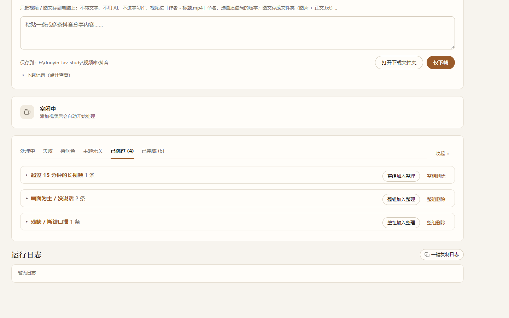

**防封号**：下载、读详情一律一条一条来；小红书每条之间随机歇几秒，每天有上限，被限流或要验证就自动冷却（重启也记得）；登录用的浏览器窗口不反复开关、不反复刷新。

**中途关了程序**：每周 / 按月整理、代刷要处理的条目都记在 `data/` 里，下次启动自动接着做。

---

## 六、常见问题

**收藏的视频存在哪？** 默认在程序目录的 `视频库/抖音`、`视频库/小红书`，按收藏夹分类分文件夹，文件名是「作者 - 标题」。可以在设置里改到别的盘。

**删除和彻底删除有什么区别？** 删除是放进学习库的回收站，可以恢复；彻底删除会删掉记录、笔记、高亮和专题里的位置（视频文件不动），元信息留底，以后代刷不会再刷到它，同步收藏、手动添加仍可以加回来。

**同一个视频会不会重复？** 不会。每条收藏有一个 uid（`dy:作品ID`、`xhs:笔记ID`，本地文件用文件指纹），数据库里唯一。

**能换数据目录吗？** 设环境变量 `FAVSTUDY_DATA` 就能把 `data/` 放到任何地方（比如跑一份演示数据）。

**和原项目有什么不同？** 这是 [yuanshengbo8-sketch/douyin-fav-study](https://github.com/yuanshengbo8-sketch/douyin-fav-study) 的分支：加了小红书、阅读版学习库、专题整理、代刷、精品、划线笔记、每周 / 按月整理和防封号。原项目的 Windows 安装包不含这些功能，请用上面的脚本安装。

---

## 演示数据 · Demo data

```bash
python scripts/make_demo.py demo_data
```

然后用这份数据启动（不碰你自己的数据）：

| 系统 | 命令 |
|---|---|
| Windows（PowerShell） | `$env:FAVSTUDY_DATA="demo_data"; .venv\Scripts\python -X utf8 -m app --port 8770` |
| Mac / Linux | `FAVSTUDY_DATA=demo_data .venv/bin/python -m app --port 8770` |

里面有 6 篇示例文章、4 条已跳过、一个「网球 › 基本功 › 正手和发球」专题（带笔记、精品和高亮）。文章是编的，「原视频」放不出来。

---

## 文件结构

```
douyin-fav-study/
├─ app/                    程序代码
│  ├─ server.py            本地网页服务（http://127.0.0.1:8765）
│  ├─ worker.py            后台任务：同步、下载、转写、润色、每周整理、代刷
│  ├─ douyin.py / xhs.py   抖音、小红书：登录、收藏列表、搜索、读详情
│  ├─ xhs_bridge.py        调 XHS-Downloader（最低画质）
│  ├─ transcribe.py        本机语音转文字（faster-whisper / mlx-whisper）
│  ├─ yuedu.py             保留原话的润色排版、分类表
│  ├─ reader_*.py          学习库阅读版、专题整理、精品、划线
│  ├─ topics.py            专题、专题笔记、高亮、复制到桌面
│  ├─ db.py                SQLite（uid 去重）
│  └─ static/              主程序网页
├─ data/                   你的数据（不会上传）：数据库、笔记、设置、登录状态、模型
├─ 视频库/                  本地视频库（不会上传）
│  ├─ 抖音/                 按收藏夹分类分文件夹
│  └─ 小红书/
├─ tools/                  外部工具（不会上传）：XHS-Downloader
├─ scripts/make_demo.py    生成演示数据
├─ installer/              Windows 安装包脚本和图标
└─ docs/                   logo 和截图
```

`data/`、`视频库/`、`tools/` 都在 `.gitignore` 里。

---

## 隐私与安全 · Privacy

- 所有数据都在你自己的电脑上：数据库、笔记、视频、登录状态
- 发出去的只有：转出来的文字（发给你选的 AI）、抖音 / 小红书本身的网页请求（用你自己的登录，和你手动刷一样）
- API Key 只存在本机 `data/settings.json`；不用 Key 的本机订阅（Claude Code / Codex）走你电脑上已经登录的命令行

## 免责声明 · Disclaimer

本工具只用于整理你自己收藏的内容、个人学习。请遵守抖音、小红书的用户协议和内容版权，不要批量搬运、传播他人作品。下载和搜索都放慢了速度，但账号风控由平台决定，使用风险自负。

## 致谢与许可证 · Credits & License

- 原项目：[yuanshengbo8-sketch/douyin-fav-study](https://github.com/yuanshengbo8-sketch/douyin-fav-study)
- 小红书下载：[JoeanAmier/XHS-Downloader](https://github.com/JoeanAmier/XHS-Downloader)
- 语音识别：[faster-whisper](https://github.com/SYSTRAN/faster-whisper)、[mlx-whisper](https://github.com/ml-explore/mlx-examples)

许可证：[PolyForm Noncommercial 1.0.0](LICENSE.md)，只允许非商业使用。

Required Notice: Copyright (c) 2026 yuanshengbo8-sketch (https://github.com/yuanshengbo8-sketch/douyin-fav-study)
